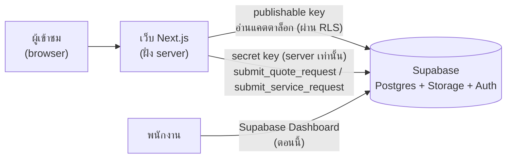
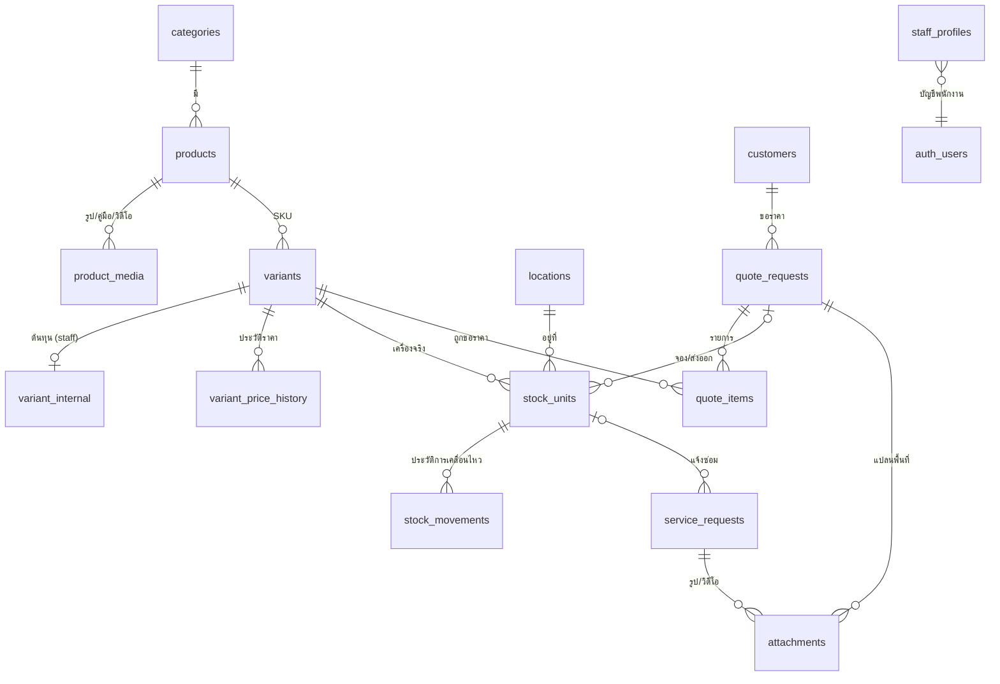
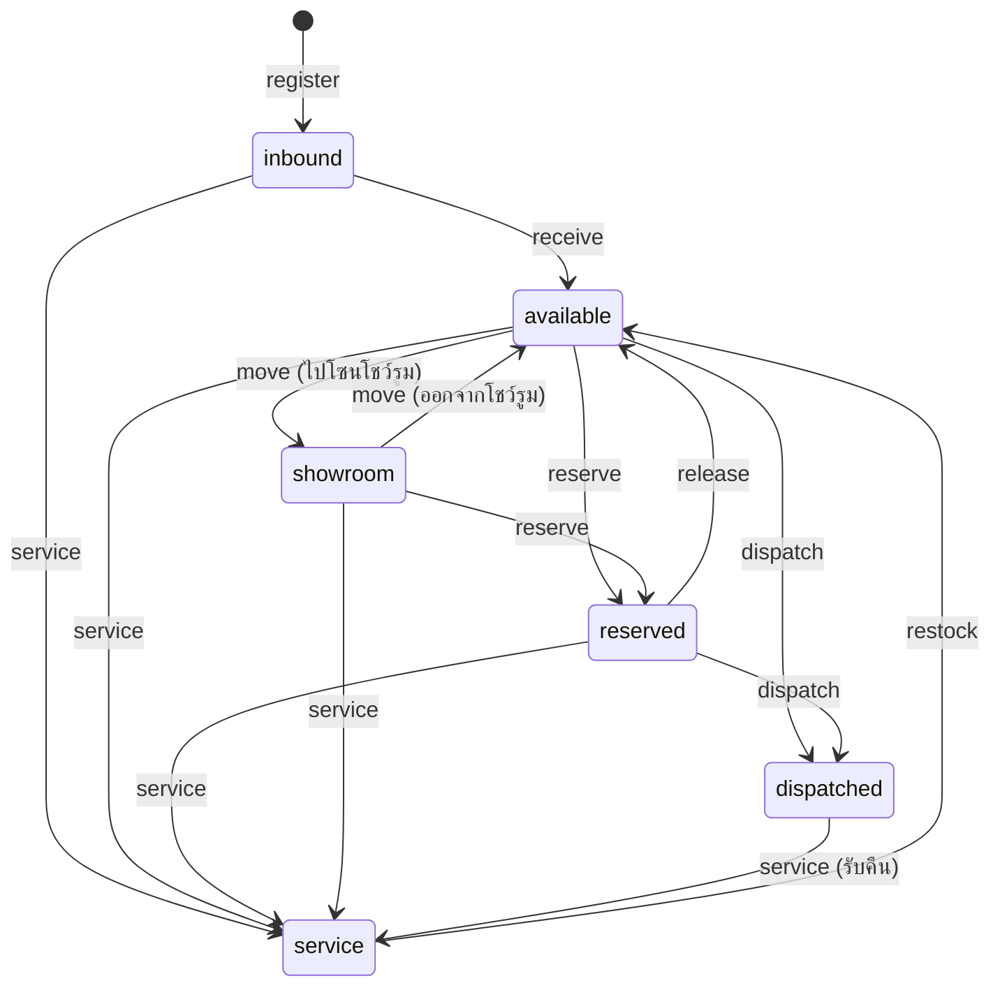

# ออกแบบฐานข้อมูล — Fitness Equipment Asia (Supabase / PostgreSQL)

เอกสารนี้อธิบายโครงสร้างฐานข้อมูลที่อยู่ใน `supabase/migrations/` และวิธีที่ระบบฝั่ง server คุยกับ Supabase
ออกแบบจากสิ่งที่หน้าเว็บ (repo Frontend) ต้องใช้จริง: แคตตาล็อกสินค้า, รายการขอใบเสนอราคา,
ฟอร์มแจ้งซ่อม และหน้าสแกน QR ของพนักงานคลัง

**ขอบเขตตอนนี้: เว็บแคตตาล็อก + ขอใบเสนอราคา** ยังไม่มีการซื้อขายหรือรับชำระเงินออนไลน์
ลูกค้าดูสินค้า → ส่งคำขอใบเสนอราคา → ทีมงานติดต่อกลับพร้อมใบเสนอราคา การชำระเงินทำนอกเว็บ
ถ้าตัดสินใจเปิดขายออนไลน์ภายหลัง ให้เพิ่มตาราง orders / payments เป็น migration ใหม่ (ดูข้อ 7)

**ราคาทั้งหมดในฐานข้อมูลเป็นราคายังไม่รวม VAT** VAT คิดตอนออกใบเสนอราคา

## 1. ภาพรวมสถาปัตยกรรม



ตอนนี้ฝั่ง server ของ Next.js (Server Actions) ทำหน้าที่เป็น backend: key ทั้งสองตัวอยู่บน server เท่านั้น
ไม่เคยถูกส่งไป browser ถ้าภายหลังแยก API server ออกมา ฟังก์ชันในฐานข้อมูลยังใช้ได้เหมือนเดิม

หลักการ 3 ข้อ

1. **ปิดไว้ก่อน (deny by default)** — ทุกตารางเปิด Row Level Security (RLS) ใครจะเห็นอะไรต้องมี policy อนุญาตเท่านั้น
2. **ลูกค้าไม่ต้อง login** — ฟอร์มส่งไปที่ server, server เรียกฟังก์ชันในฐานข้อมูลด้วย secret key
   ฟังก์ชันพวกนี้ (`submit_quote_request`, `submit_service_request`) เรียกด้วย publishable key ไม่ได้
3. **พนักงาน login ด้วย Supabase Auth** — สิทธิ์ตามบทบาท และบันทึกได้ว่า "ใครเป็นคนทำ" (`auth.uid()`)
   ตอนนี้พนักงานจัดการข้อมูลผ่าน Supabase Dashboard ได้เลย หน้าแอดมินในเว็บค่อยทำภายหลัง

## 2. ER Diagram



## 3. ตารางทั้งหมด (16 ตาราง)

### 3.1 แคตตาล็อก

| ตาราง | หน้าที่ | คอลัมน์สำคัญ |
| --- | --- | --- |
| `categories` | หมวดสินค้า | `id` เป็น slug เช่น `plate-loaded`, `name_th/en/zh`, `sort` |
| `products` | รุ่นสินค้า (1 หน้า product) | `slug`, `model`, `name_th/en/zh`, `setting` (home/commercial), `arrived_at` + `new_override` (ป้าย NEW), `curated_rank`, `specs` (jsonb), `status` draft/published/archived, `is_demo` |
| `product_media` | รูป, คู่มือ PDF, วิดีโอ | `kind`, `storage_path` หรือ `external_url`, `width/height/alt`, `sort` |
| `variants` | SKU (สี/สเปก) — **ราคาและสถานะสต็อกอยู่ที่นี่** | `sku`, `price_thb` (**ไม่รวม VAT; null = สอบถามราคา ไม่ใช่ 0**), `stock_status` ready/preorder/import/out, `lead_time` |
| `variant_internal` | ข้อมูลภายใน แยกตารางเพื่อไม่ให้หลุดไปหน้าเว็บ | `cost_thb`, `supplier`, `hs_code`, ขนาด/น้ำหนักกล่อง |
| `variant_price_history` | บันทึกทุกครั้งที่ราคาขายหรือต้นทุนเปลี่ยน (trigger อัตโนมัติ) | `field`, `old_value`, `new_value`, `changed_by` |
| `exchange_rates` | อัตราแลกเปลี่ยน | `currency`, `thb_per_unit`, `effective_at` |

### 3.2 คลังสินค้า (หน้า `/staff` สแกน QR)

| ตาราง | หน้าที่ | คอลัมน์สำคัญ |
| --- | --- | --- |
| `locations` | ตำแหน่งในคลัง/โชว์รูม | `id` เช่น `WH-A-02-14`, `kind` receiving/warehouse/showroom/service/transit |
| `stock_units` | เครื่องจริงแต่ละเครื่อง = 1 QR | `unit_code` (`U-000184`), `sku`, `serial`, `location_id`, `state`, `quote_id` (จองให้ใบเสนอราคาไหน) |
| `stock_movements` | ประวัติทุกการเคลื่อนไหว **แก้/ลบไม่ได้** (trigger บล็อก) | `action`, `from_state → to_state`, `from/to_location_id`, `actor`, `note` |

### 3.3 ลูกค้า ใบเสนอราคา และงานบริการ

| ตาราง | หน้าที่ | คอลัมน์สำคัญ |
| --- | --- | --- |
| `customers` | ลูกค้า 1 คนต่อ 1 ช่องทางติดต่อ (LINE ID เดียวกันไม่ซ้ำ ไม่สนตัวพิมพ์) | `contact_method`, `contact_value`, `company`, `country` |
| `quote_requests` | คำขอใบเสนอราคา (หน้า `/quote`) | `reference` `Q-2026-00001`, ข้อมูลติดต่อ, การติดตั้ง, การขนเข้า 4 ช่อง, `budget_text`, `status`, `quoted_total_thb` (ไม่รวม VAT), `vat_rate`, `quoted_vat_thb` / `quoted_grand_total_thb` (คำนวณอัตโนมัติ), `quoted_at`, `closed_at`, `lost_reason` |
| `quote_items` | สินค้าในคำขอ (คำขอแบบ "ขอคำแนะนำจัดชุดยิม" ไม่มีรายการได้) | `sku`, `qty`, `note`, `list_price_thb` (ราคาหน้าเว็บตอนขอ), `quoted_unit_price_thb` (ราคาที่เสนอจริง), `unit_cost_thb` (snapshot ต้นทุน) |
| `service_requests` | แจ้งซ่อม (หน้า `/showroom`) | `reference` `SR-2026-00001`, `product_model`, `unit_code_input` (ที่ลูกค้าพิมพ์) + `unit_code` (ถ้าตรงกับเครื่องจริง), `symptom`, `status` |
| `attachments` | ไฟล์แนบของใบเสนอราคา/แจ้งซ่อม | `bucket`, `storage_path`, `mime_type`, `size_bytes` |

### 3.4 พนักงาน

| ตาราง | หน้าที่ |
| --- | --- |
| `staff_profiles` | ผูก `auth.users` กับบทบาท `admin` / `sales` / `warehouse` / `service` — สมัคร Auth อย่างเดียวยังไม่ได้สิทธิ์อะไร ต้องมีแถวในตารางนี้ |

### 3.5 VAT ในใบเสนอราคา

ราคาสินค้าทุกตัวเก็บแบบ **ไม่รวม VAT** เมื่อทีมงานกรอก `quoted_total_thb` ฐานข้อมูลคำนวณให้เอง:

```
quoted_vat_thb         = quoted_total_thb × vat_rate / 100        (ค่าเริ่มต้น vat_rate = 7)
quoted_grand_total_thb = quoted_total_thb + quoted_vat_thb
```

ส่งออกไปลาว/เมียนมา/จีน โดยทั่วไปเป็นการส่งออกที่ VAT 0% ให้ทีมงานตั้ง `vat_rate = 0` ในใบนั้น
(ควรยืนยันกับนักบัญชีของบริษัทอีกครั้ง)

## 4. สิทธิ์การเข้าถึง (RLS)

admin ผ่านทุกเงื่อนไข / ✓ = อ่าน / ✎ = แก้ไข / fn = ทำได้ผ่านฟังก์ชันเท่านั้น

| ข้อมูล | ผู้เข้าชม (anon) | sales | warehouse | service |
| --- | --- | --- | --- | --- |
| สินค้าที่ published, หมวด, อัตราแลกเปลี่ยน | ✓ | ✓✎ | ✓ | ✓ |
| สินค้า draft | – | ✓✎ | ✓ | ✓ |
| ต้นทุน `variant_internal`, ประวัติราคา | – | ✓ (แก้ต้นทุนได้เฉพาะ admin) | – | – |
| คลัง `stock_units`, `stock_movements` | – | ✓ | ✓ fn | ✓ fn (service/restock) |
| ลูกค้า | – | ✓✎ | – | ✓ |
| ใบเสนอราคา | – (ส่งผ่าน server) | ✓✎ | – | – |
| แจ้งซ่อม | – (ส่งผ่าน server) | ✓✎ | – | ✓✎ |
| รายงาน `won_quotes_monthly`, `quote_funnel_monthly` | – | ✓ | – | – |

## 5. ฝั่ง server คุยกับฐานข้อมูลอย่างไร

### 5.1 Views (อ่าน)

| View | ใช้ทำอะไร |
| --- | --- |
| `products_public` | แคตตาล็อกหน้าเว็บ: สินค้า published + variants + รูปหลัก + `is_new` (มาถึงภายใน 45 วัน หรือ staff บังคับ) — anon อ่านได้ |
| `current_exchange_rates` | อัตราล่าสุดต่อสกุลเงิน |
| `variant_stock_summary` | จำนวนเครื่องแยกตามสถานะต่อ SKU + `needs_review` (หน้าเว็บบอก "พร้อมส่ง" แต่ไม่มีของ) |
| `won_quotes_monthly` | ใบเสนอราคาที่ปิดได้ รายเดือน: รายได้, ต้นทุน, กำไรขั้นต้น, Gross margin (ไม่รวม VAT) |
| `quote_funnel_monthly` | จำนวนคำขอ, เสนอแล้ว, Win rate, เวลาเฉลี่ยจนเสนอราคา (ชม.), มูลค่าที่ปิดได้ |

ทุก view ตั้ง `security_invoker = true` แปลว่า RLS ของคนที่เรียกยังทำงาน (Supabase แนะนำแบบนี้)

### 5.2 ฟังก์ชัน (เขียน)

| ฟังก์ชัน | ใครเรียกได้ | ทำอะไร |
| --- | --- | --- |
| `submit_quote_request(payload)` | server (secret key) | ตรวจข้อมูล, สร้าง/อัปเดตลูกค้า, ออกเลข `Q-…`, รวมรายการ SKU ซ้ำ, เก็บราคาหน้าเว็บและต้นทุน ณ ตอนนั้น |
| `submit_service_request(payload)` | server | ออกเลข `SR-…`, จับคู่หมายเลขเครื่องถ้ามีในระบบ |
| `register_attachment(ref, bucket, path, mime, size)` | server | ผูกไฟล์ที่อัปโหลดแล้วกับใบเสนอราคา/แจ้งซ่อม |
| `stock_register_unit(...)` | พนักงาน warehouse | ลงทะเบียนเครื่องใหม่เป็น `inbound` |
| `stock_apply_action(unit, action, ...)` | พนักงาน warehouse (service: เฉพาะ service/restock) | เปลี่ยนสถานะเครื่องตามกฎด้านล่าง + เขียนประวัติ |

ข้อผิดพลาดจากการตรวจข้อมูลจะเป็น SQLSTATE `22023` พร้อมข้อความสั้น ๆ เช่น `missing:contact_name`,
`unknown_sku:FEA-X`, `invalid_transition:dispatched:move` → แปลงเป็น HTTP 400 / ข้อความถึงลูกค้า;
`forbidden` (`42501`) → 403

### 5.3 กฎการเปลี่ยนสถานะเครื่อง (state machine)



### 5.4 ตัวอย่างโค้ด (ใช้จริงใน repo Frontend)

```ts
// src/lib/catalog.ts — แคตตาล็อก
const { data } = await catalogClient().from("products_public").select("*").order("curated_rank");

// src/app/(site)/quote/actions.ts — Server Action, secret key อยู่บน server เท่านั้น
const { data, error } = await serviceClient().rpc("submit_quote_request", { payload });
// data = { id, reference: "Q-2026-00001" }
```

## 6. เหตุผลของการออกแบบ (ใช้ประกอบรายงานได้)

1. **ราคาเป็น `null` ได้ แต่ห้ามเป็น 0** (`check (price_thb > 0)`) — ตรงกับกติกาใน frontend ที่ว่าสินค้าที่ไม่มีราคาต้องแสดง "สอบถามราคา"
2. **เก็บราคาไม่รวม VAT และคำนวณ VAT ตอนเสนอราคา** — อัตรา VAT ต่างกันตามปลายทาง (ในประเทศ 7%, ส่งออกโดยทั่วไป 0%) จึงเก็บอัตราไว้ต่อใบเสนอราคา
3. **แยกต้นทุนออกเป็นตาราง `variant_internal`** แทนการซ่อนคอลัมน์ — anon อ่าน `variants` ได้ทั้งแถวโดยไม่มีทางเห็นต้นทุน
4. **Snapshot ราคาและต้นทุนในรายการใบเสนอราคา** — ราคาหรือต้นทุนเปลี่ยนภายหลังก็ไม่กระทบตัวเลขเก่า คำนวณกำไรขั้นต้นย้อนหลังได้ถูกต้อง
5. **ประวัติราคา (`variant_price_history`)** — เก็บอัตโนมัติด้วย trigger ใช้วิเคราะห์ margin trend หรือผลของการปรับราคาได้
6. **`stock_movements` แบบ append-only** — เป็นหลักฐานตรวจสอบ (audit trail) เหมือนสมุดบัญชีที่แก้ไม่ได้ ถ้าผิดให้บันทึกรายการแก้ใหม่
7. **เปลี่ยนสต็อกผ่านฟังก์ชันเท่านั้น** — การสแกน QR แค่เปิดข้อมูล การเปลี่ยนสถานะต้องผ่านกฎ state machine และบันทึกผู้ทำทุกครั้ง
8. **เลขอ้างอิงอ่านง่าย** `Q-2026-00001`, `SR-…` — นับแยกต่อปี (เวลาไทย) ปลอดภัยเมื่อมีหลายคำขอพร้อมกัน
9. **ลูกค้าไม่ซ้ำตามช่องทางติดต่อ** — ลูกค้าที่ขอราคาหลายครั้งจะรวมเป็นคนเดียว ใช้คำนวณ conversion rate / customer lifetime value ได้
10. **ข้อมูล spec เป็น `jsonb`** — สินค้าแต่ละประเภทมีสเปกไม่เหมือนกัน และใช้แค่แสดงผล ไม่ได้ใช้ค้นหา จึงไม่ต้องแยกตาราง

## 7. สิ่งที่ยังต้องตัดสินใจ / ทำต่อ

- **การซื้อขายออนไลน์** — ยังไม่มีในฐานข้อมูล ถ้าตัดสินใจเปิด ให้เพิ่ม migration ใหม่: `orders`, `order_items` (snapshot ราคา/ต้นทุน),
  `payments` (`provider`, `provider_ref`, สลิปโอนเงิน) และฟังก์ชัน `place_order` ที่คิดราคาจากฐานข้อมูลเอง
  หน้า checkout ใน frontend ยังเก็บไว้ ปิดด้วย `checkoutEnabled = false` ใน `src/lib/site.ts`
- **หน้าแอดมิน / หน้าสแกน QR จริง** — ตอนนี้ใช้ Supabase Dashboard จัดการข้อมูล หน้า `/staff` ยังเป็นข้อมูลตัวอย่าง (ต้องทำระบบ login พนักงานก่อน)
- **อัตราแลกเปลี่ยน USD** — มีตาราง `exchange_rates` แล้ว แต่หน้าเว็บยังใช้ค่า 36 ที่เขียนไว้ในโค้ด
- **แจ้งเตือนทีมงานเมื่อมีคำขอใหม่** (LINE Notify/อีเมล) — ทำได้ด้วย Supabase Database Webhook
- **กันสแปมฟอร์ม** (rate limit / CAPTCHA) — ควรเพิ่มก่อนเปิดเว็บจริง
- ชื่อหมวด `plate-loaded` ใน sample data ของ frontend สลับ `nameTh`/`nameEn` กัน ใน seed เก็บตามภาษาที่ถูกต้องแล้ว
